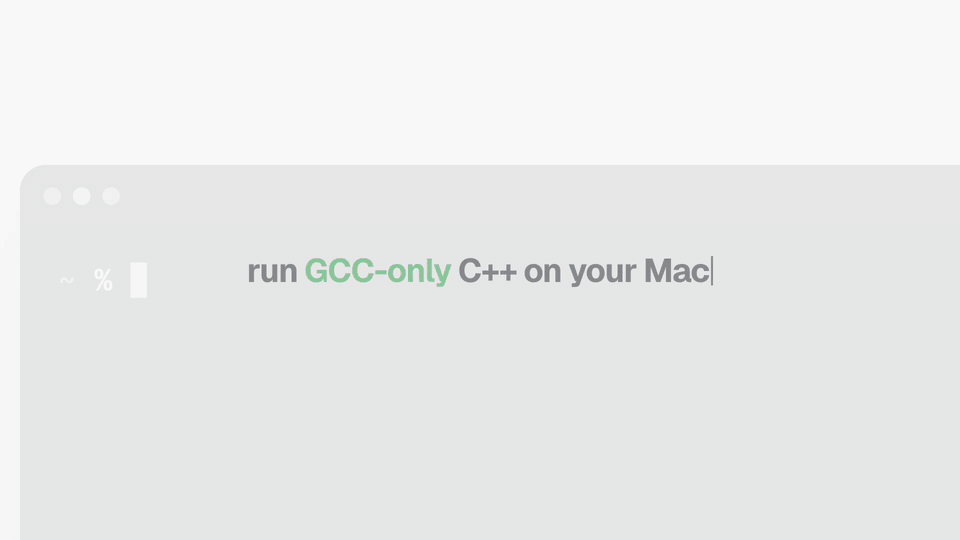

# cp-mac

**Competitive programming on a Mac, without the GCC-only errors.**

On macOS, `g++` is really Apple Clang, so code that works on every judge fails locally:

```
fatal error: 'bits/stdc++.h' file not found
fatal error: 'ext/pb_ds/assoc_container.hpp' file not found
error: no member named '__lg' in namespace 'std'
error: no member named 'random_shuffle' in namespace 'std'
Segmentation fault: 11          ← deep DFS, because macOS gives you an 8 MB stack
```

cp-mac fixes all of these with one install. You keep using Apple Clang, with no GCC download and no editor reconfiguration.



[](https://github.com/Paras-ydv/cp-mac/actions/workflows/ci.yml)

## Install

**One command** (recommended; works on Intel and Apple Silicon):

```sh
curl -fsSL https://raw.githubusercontent.com/Paras-ydv/cp-mac/main/install.sh | sh
```

It installs the latest release into `/usr/local` and asks for your password only if that folder needs it.

**Homebrew:**

```sh
brew install paras-ydv/cp/cp-mac
cp-mac link        # Apple Silicon only, once: lets Apple Clang find Homebrew's headers
```

Pick one method. The script and Homebrew installs refuse to overwrite each other.

**From source:**

```sh
git clone https://github.com/Paras-ydv/cp-mac && cd cp-mac && make install
```

Then check that everything works:

```sh
cp-mac doctor
```

You need Apple's compiler (`xcode-select --install`), which you most likely already have.

## What you get

| Works after installing | Notes |
|---|---|
| `#include <bits/stdc++.h>` | Adapts to your Clang version and `-std=` (C++11 to C++26), so it doesn't break when Xcode updates |
| `#include <bits/extc++.h>` | Everything above + pb_ds + rope |
| **pb_ds**: `ordered_set` (`tree` + `find_by_order` / `order_of_key`), `gp_hash_table`, `cc_hash_table`, `trie`, `__gnu_pbds::priority_queue` (with `join` / `modify`) | GCC's real implementation, so behaviour matches the judge |
| **rope**: `__gnu_cxx::rope`, `crope` | GCC's real implementation; also usable as an `unordered_set` key |
| `std::__gcd`, `std::__lg` | `__gcd` gives the same results as GCC, including signs; `__lg` is `constexpr` |
| `random_shuffle`, `unary_function`, `binary_function`, `bind1st`, `bind2nd`, `ptr_fun`, `auto_ptr`, `not1`, `result_of` in C++17 and later | GCC only deprecates these; Apple's library deletes them |
| `using namespace __gnu_cxx;` | No longer an error |
| `-D_GLIBCXX_DEBUG` | Turns on libc++'s bounds checks, like GCC's debug mode |
| `cprun` | Compile and run with CP flags, a **256 MB stack**, a precompiled `bits/stdc++.h` and a time/memory report |

## Usage

Write code exactly as you would for Codeforces / AtCoder / CodeChef:

```cpp
#include <bits/stdc++.h>
#include <ext/pb_ds/assoc_container.hpp>
#include <ext/pb_ds/tree_policy.hpp>
using namespace std;
using namespace __gnu_pbds;

template <class T>
using ordered_set = tree<T, null_type, less<T>, rb_tree_tag, tree_order_statistics_node_update>;

int main() {
    ordered_set<int> s;
    for (int x : {5, 1, 9, 3}) s.insert(x);
    cout << *s.find_by_order(1) << " " << s.order_of_key(6) << "\n";  // 3 3
}
```

Compile it however you like. `clang++ a.cpp` and `g++ a.cpp` work with no extra flags (see [Editors](#editors) for IDEs). Or use `cprun`:

```sh
cprun a.cpp < in.txt          # -std=c++17 -O2 -Wall -DLOCAL, big stack, recompiles only when changed
cprun -s c++20 a.cpp          # another standard
cprun -d a.cpp < in.txt       # debug: -D_GLIBCXX_DEBUG + AddressSanitizer + UBSan
```

After the program finishes, `cprun` prints what a judge would look at:

```
[0.12 s CPU, 34.1 MB]
```

It precompiles `<bits/stdc++.h>` once per set of flags, so recompiling after an edit takes a fraction of a second instead of about a second (`--no-pch` turns this off). Files that `#define` something before including `<bits/stdc++.h>` are compiled normally.

### Why `cprun`? The stack

macOS gives programs an 8 MB stack. Codeforces gives 256 MB. A recursive DFS on a 10⁵–10⁶ node path tree works on the judge and crashes on your Mac. `cprun` links with `-Wl,-stack_size,0x10000000` (256 MB). If you use your own build command, add that flag.

## Editors

Apple Clang searches `/usr/local/include` on its own, so anything that runs `clang++` / `g++` plainly just works. (Homebrew on Apple Silicon: run `cp-mac link` once first.)

- **Terminal, Sublime, Vim, Neovim**: nothing to configure.
- **VS Code** (C/C++ extension): set the compiler path to `/usr/bin/clang++`; IntelliSense then finds the headers. For Code Runner, set the C++ command to `cd $dir && cprun $fileName` and turn on `code-runner.runInTerminal` so you can type input.
- **CLion / CMake**: works with CMake 4. With CMake 3, or if you set `CMAKE_OSX_SYSROOT`, add `include_directories(SYSTEM /usr/local/include)`.
- **Xcode**: Xcode always passes an SDK (`-isysroot`), which turns off the `/usr/local/include` search. Add `/usr/local/include` to *Header Search Paths*, and `-Wl,-stack_size,0x10000000` to *Other Linker Flags* for the big stack.
- **Homebrew's LLVM** (`/opt/homebrew/opt/llvm/bin/clang++`) doesn't search `/usr/local/include` either; use `cprun` or add `-I/usr/local/include`.

## Commands

```
cp-mac run FILE.cpp          compile & run (alias: cprun)
cp-mac doctor                check everything works and explain what doesn't
cp-mac link | unlink         (Homebrew on Apple Silicon) expose headers to Apple Clang
cp-mac update                install the latest release
cp-mac autoupdate on | off   install new releases automatically, once a day (macOS)
cp-mac uninstall             remove everything cp-mac installed
cp-mac version               print the version
```

## Updates

cp-mac follows releases, not every commit. Once a day at most, `cprun` and `cp-mac` check in the background whether a newer release exists and print one line if it does:

```
cp-mac 1.1.0 is available (you have 1.0.0). Update with: cp-mac update
```

`cp-mac update` works for both install methods (for Homebrew it runs `brew upgrade`). If you'd rather not think about it, `cp-mac autoupdate on` installs new releases in the background once a day. That needs no password for Homebrew installs, or for script installs into a folder you own. Turn the check off with `CPMAC_NO_UPDATE_CHECK=1`. Installs from `main` or a specific commit (`CPMAC_REF=main`) are labelled like `1.0.0-dev`, and `cp-mac update` moves them to the latest release.

## Differences from GCC you should know about

cp-mac can't change the hardware:

- **`long double`** is 64-bit on Apple Silicon (same as `double`), but 80-bit on x86 judges. Precision-sensitive answers can differ.
- **`#pragma GCC target("avx2")` / `optimize`** do nothing with Clang (plain `clang++ -Wall` warns about them; `cprun` doesn't). AVX doesn't exist on Apple Silicon.
- **`bitset::_Find_first()` / `_Find_next()`** are GCC-only members and can't be added to Apple's `std::bitset`. Loop with `b[i]`, or keep the bits in `unsigned long long` words and use `__builtin_ctzll`.
- **`__float128`** isn't supported by Clang on macOS.
- **Include `<bits/stdc++.h>` first.** It has to switch some things on before any other standard header is read. If `<iostream>` (say) comes first, `random_shuffle` and friends are missing at C++17+ and `-D_GLIBCXX_DEBUG` checks nothing. `cprun` takes care of this for you either way.
- pb_ds's own internal debug checks stay off under `-D_GLIBCXX_DEBUG`; the standard containers are still checked.

## How it works

- `include/bits/stdc++.h` includes every standard header your compiler actually has, by checking with `__has_include`. Before that, it enables libc++'s compatibility switches for removed C++98 helpers.
- `include/ext/` is **GCC's own pb_ds and rope source**, run through [`scripts/vendor-gcc.sh`](scripts/vendor-gcc.sh). The script mechanically swaps libstdc++-internal names for small standard-library-based stand-ins in `include/cp-mac/`. No data structure code is rewritten, so behaviour matches GCC.
- The install script puts everything into `/usr/local/include`, which Apple Clang searches out of the box. Homebrew on Apple Silicon installs into `/opt/homebrew/include` instead, and `cp-mac link` adds links to it from `/usr/local/include` (one per cp-mac file, nothing else in that folder is touched; `brew upgrade` keeps them working).
- If you also use real GCC (`g++-15` from Homebrew), it keeps using its own `<bits/stdc++.h>`, even if cp-mac's folder is on its include path.

CI runs the full test suite on real macOS 15 and 26, on both Apple Silicon and Intel, plus the oldest Xcode GitHub offers (16.0), Linux with clang + libc++, and GCC. It runs on every change and every week, so breakage from new Xcode versions shows up quickly.

## Uninstall

```sh
cp-mac uninstall                              # script install (curl | sh)
make uninstall                                # make install from a clone
cp-mac uninstall && brew uninstall cp-mac     # Homebrew (removes the links first)
```

## Troubleshooting

Run `cp-mac doctor` first. It checks your compiler, finds out which `bits/stdc++.h` gets used, tests every feature, and says what to do about anything that fails.

- **An old `bits/stdc++.h` you copied in by hand** is moved aside (renamed `*.bak-<date>`) when you install or link, so it can't shadow cp-mac's.
- **`brew install cp-mac` fails with "untrusted tap"**: use the full name, `brew install paras-ydv/cp/cp-mac`, or run `brew trust --formula paras-ydv/cp/cp-mac` once.
- **Headers not found in Xcode, CMake or Homebrew's LLVM**: see [Editors](#editors).

## Prior art

Many people have solved parts of this before, mostly by copying GCC's header by hand. These projects showed the demand and the approaches:
[khaveesh/macOS-stdc.h](https://github.com/khaveesh/macOS-stdc.h),
[prsweet/std-with-pbds](https://github.com/prsweet/std-with-pbds),
[tekfyl/bits-stdc-.h-for-mac](https://github.com/tekfyl/bits-stdc-.h-for-mac),
[makeavish/bits-stdc-.h-for-mac](https://github.com/makeavish/bits-stdc-.h-for-mac).
cp-mac aims to be the complete, tested, one-command version: rope, the C++17 removals, `__lg`, the stack size, package-manager installs, and CI on real Macs.

## Contributing

```sh
make test                          # run the tests against this checkout
CXX="clang++ -stdlib=libc++" make test
scripts/vendor-gcc.sh /path/to/gcc # update pb_ds / rope from a newer GCC
```

Found GCC-only code that still doesn't compile on your Mac? [Open an issue](https://github.com/Paras-ydv/cp-mac/issues/new/choose) with the snippet and the output of `cp-mac doctor`. See [CONTRIBUTING.md](CONTRIBUTING.md) for how the project is laid out and tested, [CHANGELOG.md](CHANGELOG.md) for what changed in each release, and [SECURITY.md](SECURITY.md) for reporting security problems privately.

## License

cp-mac's own code is [MIT](LICENSE). The pb_ds and rope headers in `include/ext/` (and `include/cp-mac/rope_support.h`, which supports rope) are GCC's, under GPLv3+ with the GCC Runtime Library Exception, the same terms GCC ships them under. Programs you compile with them carry no license obligations, as with GCC itself. See [NOTICE](NOTICE) and [third_party/gcc](third_party/gcc/).
